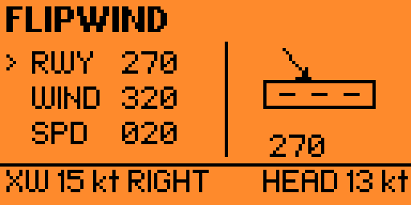

# FlipWind

**A Crosswind Calculator for Flipper Zero**

FlipWind is a lightweight Flipper Zero application designed to calculate the crosswind component of the wind relative to a runway heading. It helps pilots quickly estimate crosswind conditions using a simple, portable interface.

## Features

- **Crosswind Calculator** – Calculates the crosswind component based on wind speed, wind direction, and runway heading.
- **Simple Navigation** – Use the directional buttons to navigate the menu and adjust values.
- **Visual Wind Indicator** – Displays a runway graphic and a wind-direction arrow to help visualize the wind relative to the runway.
- **Go Fly!** – Opens the crosswind calculator.
- **About** – Displays application information and version details.
- **Safety Notice** – Provides an important aviation safety reminder.

## How to Use

1. Launch **FlipWind** from the Flipper Zero applications menu.
2. Select **Go Fly!** to open the calculator.
3. Enter or adjust the wind speed, wind direction, and runway heading.
4. Read the calculated crosswind component.
5. Use the visual indicator to understand the wind direction relative to the runway.

### Controls

- **Up / Down:** Navigate menu items.
- **Left / Right:** Adjust values.
- **OK / Center:** Select an option or confirm, depending on the current screen.
- **Back:** Return to the previous screen.

## Crosswind Calculation

The crosswind component is calculated using the following formula:

`Crosswind = Wind Speed × sin(Angle Difference)`

Where:

- **Wind Speed** is the reported wind speed.
- **Angle Difference** is the smallest angular difference between the wind direction and the runway heading, expressed in degrees.
- **Crosswind** is the wind component perpendicular to the runway.

The headwind or tailwind component can be calculated using:

`Headwind Component = Wind Speed × cos(Angle Difference)`

A positive headwind component indicates a headwind, while a negative value indicates a tailwind, subject to the application's angle convention.

## Safety Notice

**FlipWind is an informational tool only.**

Always use official weather reports, ATIS/AWOS information, current METARs, airport information, aircraft documentation, and your operator's procedures when assessing wind conditions.

Do not use this application as the sole basis for takeoff, landing, or any other flight decision. Always consider aircraft-specific crosswind limitations, gusts, runway conditions, wind variability, and applicable operational procedures.

The pilot in command remains responsible for the safe operation of the aircraft.

**HAVE A SAFE FLIGHT!**

## Version

- **Application:** FlipWind
- **Version:** 1.0
- **Platform:** Flipper Zero
- **Category:** Tools
- **Author:** marcopit

## Disclaimer

FlipWind is provided "as is", without warranties of any kind. The author accepts no responsibility for errors, incorrect calculations, or decisions made based on the application's output.

Always verify calculations and follow applicable aviation regulations and procedures.

---

**Fly safe. Stay informed.**
